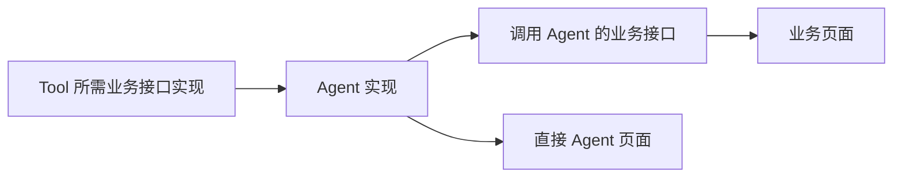

# 独立 Agent 能力与业务接口

本合同覆盖 Agent Runtime Direct 应用：多个独立 Agent、任务与会话、结构化检测结果、业务接口内部调用及两种响应方式。

## 正式事实与确认

- RequirementSpec 和 ProductPlan 定义全部业务 Agent。`entryPageIds` 只表示当前页面直接交互，导航到另一个页面不属于当前页 Agent 入口。后台能力允许没有页面入口。
- TechnicalPlan 的 `agent_contracts` 覆盖全部产品 Agent。`pageIds` 只投射启用的直接页面绑定；`publicEndpoint` 显式决定是否发布 `/agents/{agentId}/run`，不由目录或名称猜测。
- 页面入口关闭不删除 Agent 能力。页面绑定非空时必须启用公开运行入口。
- RequirementSpec/ProductPlan 继续联合确认。技术合同、接口详细设计和开发任务继续执行原正式确认门；澄清不是确认。
- JSON 是内部状态，用户审阅及修改仍使用 Markdown。当前合同切换不提供历史读取或迁移。

## 执行能力

`interactionContract.mode` 为 `task` 或 `conversation`。两者都支持 `inputSchema`、`resultSchema` 和显式 `interactionKinds`；Schema 自包含且只允许本地片段引用。

任务和会话均可只有文本；被业务接口调用的 Agent 必须声明结构化结果。`textOutput=false` 时必须提供结果 Schema。保留 `publicStateSchema=null` 与 `outcomes=[]`，不公开内部图状态。

Runtime 先验证业务输入，再执行 Agent。声明结构化结果时，优先读取图终态的 structured_response（支持 JSON 值或 Pydantic 对象），否则从最终助手消息解析 JSON；两种方式均严格通过 Schema 校验，否则报告失败，不修补或自动重试。明确结构化结果无效时不会回退到文本掩盖错误。

JSON 错误按语义区分：输入错误 422、线程冲突/待交互 409、容量不足 429、超时 504、模型/结果错误 502、Runtime 不健康 503、内部错误 500。

无交互任务不使用长期 checkpoint；会话或可交互任务复用可信 Principal、Agent、thread 隔离。任务调用使用独立线程，续接保留当前线程和交互身份。

## 业务接口调用

普通 Endpoint 保持 `kind=business`，可声明：

| 字段 | 含义 |
| --- | --- |
| `agentCall.agentId` | 正式 Agent 身份 |
| `inputBindings` | Agent 输入目标 JSON Pointer → 业务请求来源 JSON Pointer |
| `resultBindings` | 完整业务响应目标 JSON Pointer → Agent 结果来源 JSON Pointer |
| `responseMode` | `json` 或 `ag-ui` |

请求来源根对象为 `{body,path,query,header}`。空 Pointer 代表整个对象；父子目标不能同时写入。数组可整体映射。接口必须声明完整响应 Schema。

接口详细设计签认调用映射及当前 Agent 能力摘要；映射或能力变化后，旧设计必须重新确认。此分支不再同时声明另一套数据库/外部来源字段映射；复杂前后置业务由独立服务及已声明 Tool 组合，不重复实现 Agent。

业务 Service 唯一委托 `ApplicationServiceContext.agents.invoke_agent` 或 `.stream_agent`，传入冻结映射及完整响应 Schema。Tool 和 Controller 继续复用同一个 ApplicationService，不走本机 HTTP，也不重复创建模型或检测逻辑。

## 传输

2026-11-03 用户要求按本设计实施：**普通 JSON 响应的例外仅适用于生成应用的业务接口**。Studio 平台的规划、配置、确认、进度和失败流程继续使用 AG-UI。

- `json`：HTTP 请求使用普通业务 DTO，完整运行完成后返回映射且通过响应 Schema 校验的业务结果。
- `ag-ui`：使用官方 RunAgentInput；业务 DTO 放入 `forwardedProps.input`。Controller 使用模板解析器及 DTO 校验，并转交原 thread/run 身份。事件流由模板与官方编码器生成；终态携带相同结构化业务结果。
- 公开 Agent 运行入口继续使用 AG-UI/SSE；内部 Agent 无公开入口，受控 Debug Profile 可以验证它的能力。
- 待交互返回 `awaiting_user`，不代表成功。JSON 入口返回 HTTP 409、当前 thread 和 pendingInteraction；继续执行必须提交明确声明的续接字段，不能自动批准。流式入口按原 AG-UI 交互续接。
- 取消、超时或断流后的未知结果不自动重放。两种响应方式共用容量、期限及实际任务收口。

## 开发依赖与复用

接口实现拥有唯一 Endpoint Unit。先开发 Agent 时，带入 Tool 接口前置任务与确认门；随后页面复用当前契约对应的已完成实现。业务接口调用 Agent 时，带入该 Agent 和它的依赖闭包，不拉入其他无关 Agent 或消费页面。

正式规划拒绝 `业务接口 → Agent → Tool → 同一业务接口` 的循环。需要拆分底层 Tool 服务与面向用户的检测服务。

## 代码归属

- `domain/runtime_endpoint_contract.py`、`domain/agent_call.py`：执行能力与调用映射模型。
- `services/runtime_agent_calls.py`：正式映射、结果 Schema、摘要与循环检查。
- `services/runtime_endpoint_dependencies.py`、`runtime_agent_dag.py`：目标依赖闭包与既有 DAG。
- `services/runtime_execution_policy.py`：从已确认能力及实际实现签发策略，内部 Agent 不依赖公开 Endpoint。
- `builtin_templates/agent-ui-frontend`：任务表单、结构化结果及官方 AG-UI 适配器。
- 外部 `springboot-template/template-source/code/agent-runtime/base/src/app/agent/invocation.py`：共享 Runtime 执行器及业务响应适配。

模板 Source 改动同步 release revision、依赖锁和维护指南。测试均使用离线模型；本次不调用真实供应商或扫描目标系统。
