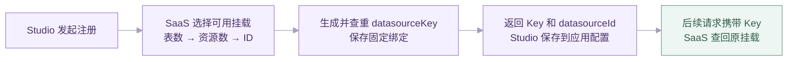

# DevAgent Studio 内置数据库整体方案评审

更新日期：2026-10-20

## 背景及问题

Studio 生成的应用在用户本地运行和调试。部分用户缺少可用的数据库资源，或无法独立完成安装与连接配置，导致代码和 SQL 生成后仍不能进行完整的页面、接口及数据验证。

本次建设由平台提供内置数据库资源，支持用户在 Studio 中完成实体设计、建表、接口开发和本地调试，并查看实际产生的数据（类似于低开模型的数据管理）。

前期评审已确定采用 SaaS 内置数据库方案。
本文围绕用户主流程，说明 Studio 各阶段的改造及 SaaS 对应的功能设计。

## 整体方案

建设独立的 `managed-database-service`，统一管理平台 TDSQL 资源。生成应用的前后端在用户本地运行，数据库由平台集中提供。

考虑到当前资源最多支持 10 个 Schema，采用共享 Schema、按数据源 Key 区分物理表的方式。例如，两个应用均包含请假申请实体时，对应的物理表分别为：

```text
应用 A：12ab34cd56ef_leave_application
应用 B：98fe76dc54ba_leave_application
```

带数据源前缀的名称即为实际物理表名。建表 SQL、字段映射、Mapper 和业务 SQL 统一使用该名称，关联查询与子查询中的表引用遵循相同规则。

Studio 负责实体设计、SQL 生成、用户确认及本地应用启动。
SaaS 负责数据源资源注册、资源挂载、表归属管理、数据库操作及结果查询。Studio 启动本地应用时，通过环境变量注入 SaaS 提供的数据库连接配置，应用读取配置后连接 MySQL。使用效果类似于用户通过 `.env` 文件提供连接信息，由 Studio 自动完成启动时的配置注入，无需用户手动维护该文件。

## 用户主流程与 Studio 改造

用户依次完成应用创建、实体规划、建表、API 设计、启动预览和数据验证。各阶段改造如下。


### 应用创建与资源注册

用户创建应用并选择内置数据库后，Studio 完成本地项目初始化，随后调用 SaaS 注册接口。注册成功后保存资源绑定，再进入规划流程。

SaaS 返回的 datasourceKey 和 datasourceId 统一保存在 `.devagentstudio/application.json`，作为后续数据库操作的应用绑定依据。首页索引和生命周期文件不重复保存注册事实。

界面统一展示“平台内置数据库”，用户无需选择挂载编号或填写连接信息。datasourceId 用于服务内部定位资源。

应用改名、重启、移动目录及同一应用的新分支复用原有 Key 和挂载，因此同应用不同分支共用模拟数据。注册结果不确定时保留当前状态，核对 SaaS 记录后再处理，避免重复注册。

### 技术规划与物理表名确定

一个实体对应一张实际业务表。生成技术规划时，Studio 根据 SaaS 分配的数据源 Key 和实体业务名确定 `datasourceKey_业务表名`，写入实体的 `table_name`。

例如，`LeaveApplication` 对应 `12ab34cd56ef_leave_application`。实体字段和完整表名随技术规划共同确认，实体详情、建表及 API 映射统一读取已确认的名称。

完整表名长度不得超过 64 个字符。超长或实体名称规范化后发生冲突时，明确提示修改，不进行自动截断。数据源 Key 允许以数字开头，SQL 统一使用反引号引用表名；Java 类名和 API 路径保留业务命名。

### 实体建表与结构变更

开发产物中的实体详情展示表名、字段设计和执行结果，提供刷新设计、创建表、重建表与刷新结果。数据源 Key 不单独展示，SQL 及复制入口不向用户展示。建表 SQL 根据已确认技术规划确定性生成；字段变更后，应重新确认规划并刷新设计。

Studio 生成的业务表必须显式声明主键，表及字段说明使用中文。表选项统一为：

```sql
ENGINE=InnoDB DEFAULT CHARSET=utf8mb4 COLLATE=utf8mb4_bin COMMENT='请假申请表';
```

“创建表”经用户明确确认后提交至 SaaS，提交前核对预览指纹与当前设计，确保执行内容与确认内容一致。

SaaS 受理后返回操作 ID，界面展示执行中，并在 10 秒后自动刷新一次。
最近操作结果与当前结构检查分别展示，例如“最近操作：创建 · 成功”表示原操作已完成，“当前结构一致”表示实际数据库符合本次设计。操作名称统一为创建、重建、删除、资源回收；历史展示不增加删除或回收入口。

实体新增或修改字段后，再次提交 CREATE 不会自动更新已有表。结构不一致时，界面提示差异并提供重建入口。重建要求受控预览已停止，并由用户明确确认清空数据；执行过程为删除旧表后重新创建，原数据不保留。

### 数据源展示与 API 设计

建表完成后，数据源面板自动读取当前应用已建成且实际存在的表，用户无需手工添加内置表或重复配置连接。

API 字段映射基于真实表和字段配置返回值、查询条件及写入列。保存映射时复核实际结构；引用字段已删除或类型、约束发生变化时，要求重新配置并确认。

代码生成将已确认的完整物理表名传递至 Mapper 和数据访问代码。例如，请假申请的写入目标为 `12ab34cd56ef_leave_application`。关联查询同样使用各表的完整物理名称，实际 SQL 行为通过后续调试验证。

### 启动检查与连接注入

用户启动预览时，Studio 根据当前已确认的全部实体生成检查用建表 SQL，提交 SaaS 与实际结构比较。检查范围包含尚未建成的实体，以识别缺表情况。

存在缺表、结构差异或未完成操作时，阻止本次启动。服务状态抽屉集中展示本轮数据库检查结果，并通过“查看实体”定位处理。检查卡片位于启动日志下方，默认折叠。

结构检查通过后执行后端构建，在 Java 启动前再次复核设计和实际结构。随后从 SaaS 获取调试连接，通过 `SPRING_DATASOURCE_*` 等环境变量注入 Java 子进程，不将连接凭据写入生成源码或应用配置。

Java 使用注入的连接启动，后端就绪后启动前端并打开预览。数据库资源异常单独展示处理建议，避免作为业务代码问题进入自动诊断修复。

标准预览与测试临时启动共用内置资源适配。连接仅注入 Java 子进程，禁用 Spring SQL 初始化、JPA 自动 DDL、Flyway 和 Liquibase；剔除继承的 SaaS 服务密钥，内置 Java 输出先脱敏再写日志。外部直连和 DBID 继续原有连接解析与诊断规则。

### 调试数据查看

用户通过预览页面或接口发起业务请求，由本地 Java 执行 SQL，数据保存至平台 MySQL。

Studio 数据源面板按表提供三个详情 Tab：

| Tab | 展示内容 |
| --- | --- |
| 表结构 | 真实字段、类型、必填、主键、默认值和说明 |
| 表数据 | 本次调试产生的真实记录，支持翻页、刷新和展开长内容 |
| 操作记录 | 当前表相关的建表、重建、删除等资源操作，以及状态和失败摘要 |

例如，提交请假申请后，可刷新“表数据”，核对请假类型、起止时间、事由等字段的实际入库结果，完成从页面操作、接口调用到数据库记录的验证。

一期提供只读数据展示，查询合同预留结构化条件，当前仅支持空条件查询。操作记录展示本应用最近 100 条资源操作中与当前表相关的记录，不包含业务数据增删改审计。

### 版本脚本交付

用户确认项目验收通过后，平台在 `backend/db/<application.branchName>/` 输出 `create.sql` 和 `alter.sql`。前者为当前全部已确认实体的完整建表语句，后者相对上一已交付版本生成增量；首版或无差异时为空。脚本只输出文件，不执行数据库变更。

版本基线保存在工程内部 `.devagentstudio/database-deliveries.json`，随工程提交，迭代时保留。增量不从 SaaS 调试库反推；基线缺失、内容被修改或资源身份变化时停止交付并提示处理。具体合同见 [实体建表与版本交付](ENTITY_TABLE_EXECUTION.md)。

## SaaS 功能设计

SaaS 为上述用户流程提供统一的资源管理能力。服务采用单模块 Java 工程，按 domain、application、infrastructure、adapter 分层组织领域规则、应用用例、数据库访问和协议适配。

Studio 前端通过 AG-UI 调用本地 FastAPI，由 FastAPI 适配 SaaS 接口，服务密钥仅由后端持有。生成应用的 JDBC 读写独立于资源管理链路。

### 数据源资源注册与 Key 分配

注册接口为 `POST /managed-database/datasources`。Studio 当前提交应用名称 `appName`，SaaS 分配 datasourceKey 和数据库挂载，持久化绑定后返回 datasourceKey、datasourceId 及注册状态。业务表由后续建表动作创建。

资源注册表另外保存 `app_key` 和 `app_name`，用于关联 Studio 应用。appKey 是可选入参，当前 Studio 未提供时保持为空，不以应用名称代替。资源身份和业务表名前缀仍由 datasourceKey 确定；应用改名继续复用原资源，本次不增加名称同步或应用 Key 补录接口。

datasourceKey 采用“当前毫秒时间戳 + 随机串”计算 SHA-256，截取前 12 位小写十六进制编码。随机串由 SecureRandom 生成，每次尝试使用新的随机内容。

编码生成后先查重，持久化时通过 `md_datasource_resource.datasource_key` 唯一键保证最终唯一性。明确发生编码冲突时重新生成，最多尝试 4 个候选；已释放或软删除记录的 Key 不复用。

Key 冲突重试属于 SaaS 内部生成逻辑。注册接口当前不支持上游幂等键，每次成功 POST 均创建新的资源记录。Studio 对响应丢失等情况保留结果未知状态，禁止自动重发注册请求。

### 数据源资源挂载与分配

数据源挂载是平台预先配置的 MySQL 资源，包含挂载 ID、数据库地址、Schema 及管理连接配置。Schema 由部署侧准备，SaaS 启动时加载配置并检查连接可用性。

新应用注册时，从可用挂载中按“已建成表数、有效资源数、datasourceId”依次升序选择。表数相同时比较资源数，两项均相同时选择较小的 datasourceId。

例如，挂载 1 有 12 张表、挂载 2 有 5 张表时，新应用优先分配至挂载 2。该规则用于初始资源分配，不代表按实际存储量或负载进行动态均衡。



绑定保存后，新增表、结构查询、数据查询及调试连接获取均使用原挂载。资源不可用时明确返回错误，不自动切换 Schema，保证应用资源位置稳定。

### 应用、表归属与操作记录

SaaS 使用三张管理表维护应用资源及执行事实：

| 管理表 | 主要内容 |
| --- | --- |
| `md_datasource_resource` | 数据源 Key、固定 datasourceId、关联应用 Key 与名称、资源状态和当前操作占用 |
| `md_datasource_table` | 应用拥有的精确物理表名、所在挂载、最近确认的建成状态 |
| `md_database_operation` | 每次建表、重建、删除或回收的操作 ID、状态和逐步执行结果 |

表名前缀由 Studio 生成，SaaS 通过精确管理目录校验归属。表名包含数据源 Key 不能作为认领、查询或删除的唯一依据。

实体设计以 Studio 已确认技术规划为准，实际结构以 MySQL 回读结果为准。SaaS 管理目录记录表归属，操作记录保存执行过程；结构是否符合当前设计，由当次检查确定。

### 建表、重建与执行状态管理

表操作接口接收 CREATE 或 REBUILD 意图及一条完整建表 SQL。SaaS 解析目标表，校验语法、主键、固定挂载和目录归属，通过后持久化操作并异步执行，返回操作 ID。

首次建表时建立归属目录，执行后回读真实结构并更新建成状态。目录外已存在的同名表按归属冲突处理，不因结构相同自动认领。

当前应用已拥有的表若满足本次 CREATE 的期望结构，则记录目标已满足，不重复创建；结构不一致时返回差异，由用户明确选择是否重建。

REBUILD 必须明确允许丢弃数据。执行前完整校验新 SQL，随后依次删除旧表、确认删除结果、执行 CREATE 并回读。删除成功但创建失败时保留逐步结果，不承诺多步 DDL 整体回滚。

同一应用的建表、重建和清理通过应用占用串行处理。操作状态包括 RUNNING、SUCCEEDED、FAILED、UNKNOWN。结果为 UNKNOWN 时保留占用，通过原操作查询及运维流程核对执行事实，不自动重放 SQL。

### 元数据查询与结构检查

表清单和字段查询以当前应用有效目录为范围，通过 `information_schema` 精确读取实际结构。列表仅返回已建成且实际存在的表，字段信息包含类型、主键、可空、默认值及注释。

启动检查使用 `POST /managed-database/datasources/{datasourceKey}/tables/check`。Studio 提交当前全部实体的 CREATE SQL，SaaS 解析期望结构，与数据库实际结构比较。

检查内容包括字段类型、长度精度、可空、默认值、自增、主键、索引、外键，以及显式指定的引擎、字符集和排序规则。返回各表结果及差异，全部满足时返回 ready。检查为只读操作，就绪结果仅代表当次检查事实。

### 运行时调试连接

`GET /managed-database/datasources/{datasourceKey}/runtime-connection` 根据应用固定挂载返回调试连接。SaaS 先检查应用有效、挂载可用且没有未完成操作，再返回给 Studio 后端。

调试账号独立于 SaaS 执行 DDL 的管理账号，由部署侧配置必要的业务读写权限。建表、重建仍由 SaaS 执行。数据库地址应可从用户机器访问，远程连接按部署配置使用 TLS。

当前每个挂载共用专用调试账号。数据源前缀提供物理表命名区分，但共用账号可能访问同一授权范围内其他应用的表，因此不提供数据库权限级应用隔离。环境变量注入用于避免凭据进入源码和配置文件，不保证对本机用户隐藏进程环境。

### 数据管理

表数据通过 `POST /managed-database/datasources/{datasourceKey}/tables/{tableName}/data/run` 查询，返回 AG-UI 事件。SaaS 根据 Key 和管理目录定位精确表名，核对真实字段后执行只读分页查询。

默认每页 20 条，最多 100 条，按主键排序，通过额外读取一条记录判断 hasMore。单元格以字符串或 null 返回，保留 bigint、decimal 精度；长字段截断时返回相应标记供界面提示。

查询合同预留 `filter.logic` 和 `filter.conditions`，用于扩展结构化筛选，例如 `leave_type = 年假`。条件扩展按真实字段校验并绑定参数值。当前仅接受空条件，非空条件明确拒绝。

### 远端资源清理（目前只提供了接口，studio未对接）

资源清理接口为 `POST /managed-database/datasources/{datasourceKey}/cleanup/run`，支持单表删除和整份数据源资源回收。流程包括精确清单预览、明确确认丢弃数据及按操作 ID 查询结果。

单表删除保留资源注册；整份数据源资源回收在全部归属表确认删除后，将资源标为 RELEASED。存在外键时按依赖处理，部分删除后失败也保留逐表证据。整个过程只操作目录中的表，不删除共享 Schema。

该能力目前由 SaaS 提供接口，尚未接入 Studio 应用删除流程。删除本地项目不会自动清理远端表。
